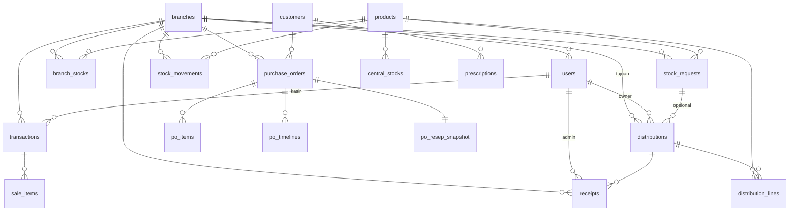

# 03 — Skema Database Konseptual (PROPOSED, tanpa migration SQL)

Konvensi: PK `id TEXT/UUID` (human-readable prefix demo: REQ-/DIST-/RC-/MU-/PO-/TRX-),
uang `INTEGER` (rupiah), qty `INTEGER CHECK (>=0)` kecuali delta bertanda, waktu
`TIMESTAMPTZ` (tampil WIB), `created_by/at`, soft-delete via `status`, tanpa hard-delete
ledger. Unique: kode produk, email, idempotency keys, `(branch,product)` stok.

Tabel: `branches(id,name,type,is_active)`; `users(id,name,email UNIQUE,pass_hash,role,
branch_id NULLABLE=global owner)`; `products`; `branch_stocks(branch,product,
qty_available,qty_minimum,version)`; `central_stocks` (+`reserved_outstanding`
derivasi); `stock_requests`; `distributions(+status)`; `distribution_lines`;
`receipts(+idem_key UNIQUE, selisih)`; `stock_movements(+event_key UNIQUE, delta,
sebelum,sesudah)`; `customers`; `prescriptions(customer,od_*,os_*,pd,add,exam_date)`;
`purchase_orders`; `po_items(price_snapshot)`; `po_timelines`; `po_resep_snapshot`;
`transactions(+idem_key UNIQUE, method, status)`; `sale_items(price_snapshot)`;
`audit_logs`. Index: `(branch_id)`, `(product_id)`, `(status)`, `(created_at)`,
pencarian `number/customer`.
